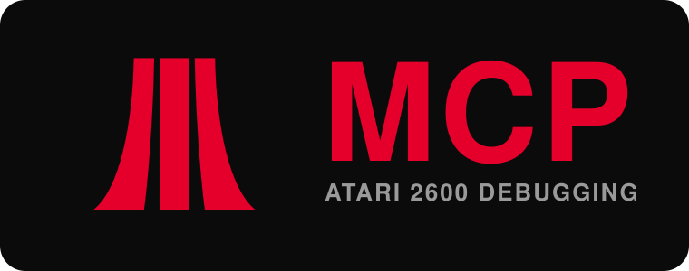
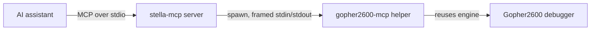

<p align="center">
  
</p>

# stella-mcp

[](https://github.com/aovestdipaperino/Stella-mcp-server/stargazers)

<p align="center">
  <a href="https://ai.enzolombardi.net/"></a>
</p>


[](https://github.com/aovestdipaperino/Stella-mcp-server/actions/workflows/ci.yml)
[](#license)

An MCP server for running and debugging Atari 2600 (VCS) games.

It exposes an interactive 6507 debugger to an AI assistant: breakpoints, single
stepping, memory and register inspection, TIA/RIOT chip state, disassembly, and
source-level (DWARF) debugging of modern ARM-coprocessor homebrew.

## How it works

Despite the name, the engine is [Gopher2600](https://github.com/JetSetIlly/Gopher2600),
chosen because its debugger has a real command interface that can be driven
programmatically, which the GUI-only Stella debugger cannot. The server drives a
small **headless** build of the Gopher2600 debugger over a framed stdin/stdout
protocol, so every command has an unambiguous request and response.



The helper (`emu/`) is a ~40 line Go program that reuses the upstream Gopher2600
debugger engine, supplying a stub GUI and a custom terminal that emits
machine-readable command frames. Because it never imports the GUI, it builds
with only the Go toolchain (no SDL or OpenGL).

## Prerequisites

- Rust (stable) and Cargo.
- Go 1.25 or newer, for building the emulator helper (`brew install go`).
- `git`, used once to fetch Gopher2600 into `third_party/`.

## Build

```sh
# 1. build the headless emulator helper (clones and prunes Gopher2600 on first run)
./scripts/build-emu.sh

# 2. build the MCP server
cargo build --release
```

The helper lands in `bin/gopher2600-mcp`; the server in `target/release/stella-mcp`.
You can also build the helper through the server's `build_emulator` tool.

## Use with an MCP client

Register the server (example for a client that reads a JSON config):

```json
{
  "mcpServers": {
    "stella": {
      "command": "/path/to/stella-mcp/target/release/stella-mcp"
    }
  }
}
```

### Claude Code

Register it for this project with the CLI:

```sh
claude mcp add stella -- "$(pwd)/target/release/stella-mcp"
```

Or commit a project-scoped `.mcp.json` at the repo root:

```json
{
  "mcpServers": {
    "stella": {
      "command": "${STELLA_MCP_BIN:-./target/release/stella-mcp}",
      "env": { "RUST_LOG": "info" }
    }
  }
}
```

Environment overrides (all optional):

- `STELLA_MCP_EMU` absolute path to the helper binary.
- `STELLA_MCP_ROOT` project root used to locate `bin/` and `scripts/`.
- `STELLA` path to a Stella binary for `play_rom`.
- `GOPHER2600` a full windowed Gopher2600 build for `play_rom`.
- `RUST_LOG` log level (logs go to stderr).

## A typical session

1. `emulator_status` to confirm the helper is built.
2. `start_session` with a ROM path. It returns a session id and the boot output.
3. `set_breakpoint` (for example `target: "0xF000"`), then `run`.
4. `step`, `cpu`, `peek`, `ram`, `tia`, `disassemble` to inspect state.
5. `stop_session` when finished.

With a single session open the `session` argument is optional.

## Tools

Lifecycle: `emulator_status`, `build_emulator`, `start_session`, `stop_session`,
`list_sessions`.

Execution: `run`, `halt`, `step`, `reset`.

Halt conditions: `set_breakpoint`, `set_trap`, `set_watch`, `list_halts`,
`drop_halt`, `clear_halts`.

Inspection: `peek`, `poke`, `cpu`, `ram`, `tia`, `riot`, `audio`, `memmap`,
`disassemble`, `last`, `screenshot` (captures the current TV frame as a PNG and
returns it inline, even though the helper is headless).

Modern homebrew: `coproc`, `dwarf` (for CDFJ, DPC+, ELF cartridges).

Input: `stick`, `panel`.

From source: `fetch_gist` (pull asm hosted in a GitHub gist via the `gh` CLI),
`build_rom` (assemble DASM / 8bitworkshop source with `dasm` into a `.bin`, plus
a `.sym` the debugger auto-loads for symbolic disassembly), and `insert_rom`
(hot-swap a built ROM into a running session). Bundled `vcs.h`/`macro.h` live in
`assets/dasm/` and are always on the include path, so 8bitworkshop sources that
`#include "vcs.h"` build unchanged.

Other: `debugger_command` (send any raw command), `rom_disassemble` (static, no
session), `play_rom` (open the ROM in a windowed emulator for visual
inspection; auto-detects Stella or a full Gopher2600).

Building from source needs `dasm` (`brew install dasm`); `fetch_gist` needs the
GitHub CLI (`brew install gh`, then `gh auth login`).

The `stella://debugger/commands` resource documents the full debugger grammar.

## Notes

- Prefer breakpoints and stepping over an unbounded `run`. `run` free-runs the
  emulation and auto-halts after a few seconds via an interrupt.
- The headless helper has no display. For visual inspection, `play_rom` opens
  the ROM in a windowed emulator (Stella or a full Gopher2600); install one with
  `brew install --cask stella`. Headless frames are available via `screenshot`.
- From a shell, `scripts/play.sh <rom>` resolves the same emulator and launches
  it, e.g. `scripts/play.sh roms/slotracers.bin`.
- `scripts/build-and-play.sh <source.asm> [out.bin]` assembles a DASM /
  8bitworkshop source (bundled `vcs.h`/`macro.h` on the include path, writing a
  `.sym`) and launches the ROM in one step, e.g.
  `scripts/build-and-play.sh tests/fixtures/colorbars.asm`.
- macOS: the Stella cask is unsigned, so Gatekeeper may quarantine (or remove)
  it. If launching fails, clear the flag once:
  `xattr -dr com.apple.quarantine /Applications/Stella.app`.

## Layout

```
src/            Rust MCP server (session protocol, tools, toolchain discovery)
emu/            Go helper: headless debugger + framed terminal (mcpterm)
scripts/        build-emu.sh
third_party/    Gopher2600 clone (git-ignored, created by the build script)
bin/            built helper (git-ignored)
```

## License

Licensed under either of

- MIT license ([LICENSE-MIT](LICENSE-MIT) or <https://opensource.org/licenses/MIT>)
- Apache License, Version 2.0 ([LICENSE-APACHE](LICENSE-APACHE) or <https://www.apache.org/licenses/LICENSE-2.0>)

at your option.

Unless you explicitly state otherwise, any contribution intentionally submitted
for inclusion in this work by you, as defined in the Apache-2.0 license, shall
be dual licensed as above, without any additional terms or conditions.

Gopher2600 is a separate project by JetSetIlly, used here under its own license;
it is fetched into `third_party/` at build time and is not redistributed by this
repository. The Atari "Fuji" mark is a trademark of Atari Interactive, Inc.; the
logo here is a fan rendering and implies no affiliation or endorsement.
